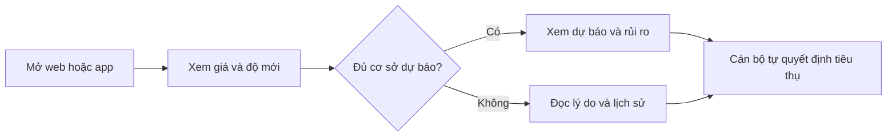

# AGTECH-01 — Bài toán và phạm vi

**Điều hướng:** [Đọc nhanh](#section-1) · [1. Bối cảnh và vấn đề](#section-2) · [2. Người dùng và giá trị](#section-3) · [3. Mục tiêu và tiêu chí thành công](#section-4) · [4. Phạm vi MVP](#section-5) · [5. Giới hạn nghiệp vụ](#section-6) · [6. Ngoài phạm vi](#section-7) · [7. Ràng buộc và phụ thuộc](#section-8) · [8. Tài liệu liên quan](#section-9)

Phiên bản 1.1 — 20/11/2026. Căn cứ: phạm vi Q1–Q29 đã được người thực hiện xác nhận. Tài liệu mô tả mục tiêu triển khai, không chứng nhận hệ thống hoặc mô hình đã hoạt động.

## Đọc nhanh

| Nội dung | Tóm tắt |
| --- | --- |
| Người dùng chính | Cán bộ hợp tác xã |
| Sản phẩm MVP | Web + Android + iOS, chung backend |
| Thị trường | Một mặt hàng, một địa bàn; ưu tiên cà phê sau kiểm chứng |
| Đầu ra AI | Dự báo 7 ngày lịch + rủi ro giá giảm |
| Quyết định bán | Thuộc người dùng |

> **Cách đọc trạng thái:** Đã chốt = được xác nhận; Đề xuất = phương án thiết kế; Cần kiểm chứng = chưa có bằng chứng đạt. Sơ đồ mô tả thiết kế mục tiêu, không chứng nhận chức năng đã triển khai.

## 1. Bối cảnh và vấn đề

Cán bộ hợp tác xã cần tổng hợp thông tin giá từ nhiều nguồn để lập kế hoạch tiêu thụ. Dữ liệu khác nhau về địa bàn, loại hàng, đơn vị và thời điểm công bố khiến việc so sánh khó khăn. Chỉ nhìn giá hiện tại chưa thể hiện được diễn biến gần đây hoặc tín hiệu cần chú ý.

Đề tài xây dựng nền tảng web và app tập trung dữ liệu, dự báo giá ngắn hạn, đánh dấu bất thường và phân loại rủi ro giá giảm. Cán bộ hợp tác xã sử dụng thông tin để tự quyết định; hệ thống không ra quyết định bán thay người dùng.

### Hành trình sử dụng

## 2. Người dùng và giá trị

| Vai trò | Nhu cầu | Giá trị mong đợi |
|---|---|---|
| Cán bộ hợp tác xã | Theo dõi giá, dự báo và diễn biến rủi ro tại địa bàn quan tâm | Có thông tin cùng nguồn, thời điểm và giới hạn sử dụng để tham khảo trước khi tiêu thụ |
| Quản trị viên | Duy trì nguồn, kiểm tra dữ liệu và các lần chạy | Phát hiện dữ liệu lỗi hoặc tác vụ thất bại; truy vết được kết quả |

| Bước | Người dùng xem | Câu hỏi được trả lời |
| --- | --- | --- |
| 1 | Giá, địa bàn, chất lượng | Giá này áp dụng cho loại hàng và nơi nào? |
| 2 | Nguồn và thời điểm | Dữ liệu còn phù hợp để tham khảo không? |
| 3 | Dự báo hoặc lý do chưa đủ cơ sở | Có thể tham khảo xu hướng bảy ngày tới không? |
| 4 | Rủi ro, bất thường và lịch sử | Tín hiệu nào cần chú ý? |
| 5 | Tổng hợp thông tin | Tự lựa chọn kế hoạch tiêu thụ |

## 3. Mục tiêu và tiêu chí thành công

- Tập hợp ba nhóm dữ liệu: giá trong nước, giá quốc tế và thời tiết; truy vết được nguồn và thời điểm.
- Cung cấp một luồng hoàn chỉnh từ thu thập, kiểm tra, lưu trữ đến dự báo, phân loại rủi ro và hiển thị trên web/app.
- Đánh giá mô hình theo thời gian với baseline giữ nguyên giá gần nhất; công bố cả trường hợp mô hình không đạt.
- Bàn giao web chạy online và app Android/iOS chạy được, có bằng chứng kiểm thử trên cả hai nền tảng.
- Lưu dự báo, đánh giá rủi ro và thông báo để kiểm tra lại quá trình vận hành.

Mức cải thiện MAE, độ dài lịch sử tối thiểu và ngưỡng cảnh báo chưa chốt. Chúng phải được xác lập qua bước kiểm chứng dữ liệu và đóng băng trước đánh giá cuối cùng. Hoàn thành phần mềm không đồng nghĩa mô hình đã đủ điều kiện cảnh báo.

## 4. Phạm vi MVP

| Thành phần | Phạm vi |
|---|---|
| Mặt hàng | Một mặt hàng, ưu tiên cà phê sau kiểm chứng dữ liệu |
| Giá | Giá thu mua cà phê nhân trong nước, VNĐ/kg; giữ thông tin chất lượng khi có |
| Địa lý | Một tỉnh hoặc vùng giá, chọn sau khảo sát |
| Dự báo | Một giá trị cho từng ngày trong bảy ngày lịch kế tiếp |
| Dữ liệu | Ba nhóm nguồn; mô hình chỉ bắt buộc dùng lịch sử giá |
| Web | Chức năng cán bộ hợp tác xã và quản trị |
| App | Android/iOS cho cán bộ hợp tác xã; dùng chung backend và dữ liệu |
| Cảnh báo | Rủi ro LOW/MEDIUM/HIGH; thông báo trong web/app, lịch sử dùng chung |
| Bất thường | Cờ trên dashboard; kiểm tra riêng, không tự chuyển thành HIGH |
| Vận hành | Thu thập theo lịch khi nguồn hỗ trợ, nhập tệp có kiểm tra, theo dõi tác vụ |

## 5. Giới hạn nghiệp vụ

Rủi ro được phân loại từ mức giảm của giá dự báo thấp nhất trong kỳ so với giá quan sát mới nhất. Các mức này không phải xác suất giảm giá. Thiếu dữ liệu, dữ liệu quá cũ hoặc mô hình chưa đạt phải dẫn đến trạng thái chưa đủ cơ sở, không gán LOW.

Không suy ra quan hệ nhân quả từ tương quan. Giá công bố là giá tham khảo theo nguồn, không mặc nhiên là giá giao dịch cụ thể của hợp tác xã. Các ngày thiếu giá không được tự tạo thành quan sát thật để tính sai số.

MVP cần mạng. Khi mất kết nối, cho thử lại và ghi rõ thời điểm dữ liệu còn hiển thị. App chưa có chế độ offline hay thông báo đẩy khi đóng.

## 6. Ngoài phạm vi

Dự báo sản lượng, SHAP, bản đồ, Kafka, email/SMS, push notification, so sánh nhiều địa bàn, quản lý kho/giao dịch và dữ liệu nội bộ riêng của từng hợp tác xã. Phát hành công khai lên Google Play/App Store là giai đoạn riêng. Chưa yêu cầu TimescaleDB.

## 7. Ràng buộc và phụ thuộc

Đồ án thực hiện cá nhân, thời gian linh hoạt. Hướng công nghệ đã chọn: Next.js, Python/FastAPI, PostgreSQL. Công nghệ app là đề xuất trong tài liệu thiết kế. Chưa có mẫu báo cáo hay tiêu chí chấm của trường.

Phụ thuộc lớn nhất là chuỗi giá nội địa đủ liên tục, nhất quán và có thể sử dụng. Nếu khảo sát không đạt, phải trình phương án thay đổi trước khi đổi mặt hàng hoặc kỳ dự báo. Các điều kiện build, cài đặt và kiểm thử iOS/Android phải được kiểm chứng sớm.

## 8. Tài liệu liên quan

- [Yêu cầu và nghiệm thu](02-YEU-CAU-VA-NGHIEM-THU.md)
- [Dữ liệu và đánh giá AI](03-DU-LIEU-VA-DANH-GIA-AI.md)
- [Thiết kế hệ thống](04-THIET-KE-HE-THONG.md)
- [Kế hoạch triển khai](05-KE-HOACH-TRIEN-KHAI.md)
