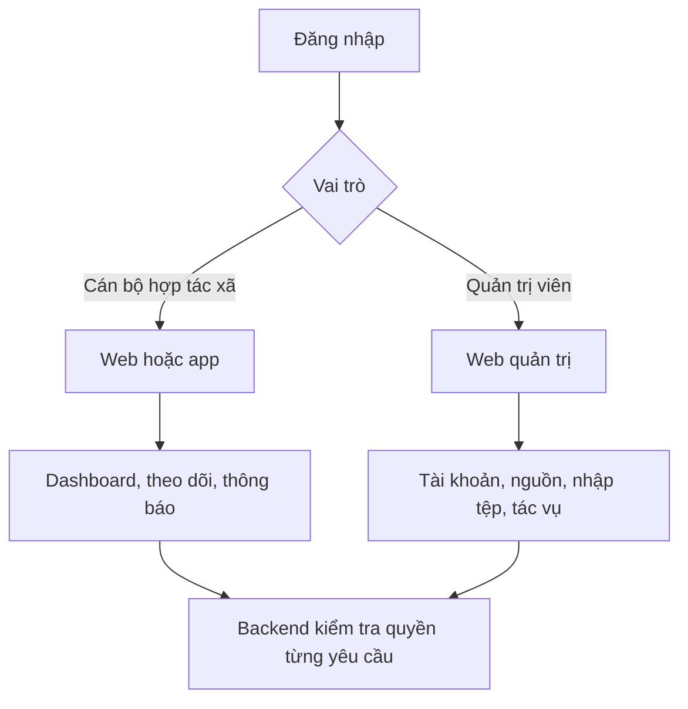

# AGTECH-01 — Đặc tả yêu cầu và tiêu chí nghiệm thu

**Điều hướng:** [Bản đồ yêu cầu](#section-1) · [1. Quyền truy cập](#section-2) · [2. Danh mục yêu cầu](#section-3) · [3. Quy tắc thông báo chi tiết đề xuất](#section-4) · [4. Yêu cầu chất lượng](#section-5) · [5. Kịch bản nghiệm thu xuyên suốt](#section-6) · [6. Điều kiện hoàn tất](#section-7)

Phiên bản 1.1 — 20/11/2026. Phạm vi nghiệp vụ đã xác nhận; các cách xử lý chi tiết dưới đây là đề xuất thiết kế để triển khai và kiểm thử. Các ngưỡng định lượng phụ thuộc dữ liệu được quản lý trong tài liệu 03.

## Bản đồ yêu cầu

| Nội dung | Tóm tắt |
| --- | --- |
| Danh tính và dữ liệu | FR-01–FR-05 |
| Phân tích và quyết định | FR-06–FR-09 |
| Theo dõi và vận hành | FR-10–FR-13 |
| Mobile và kết nối | FR-14–FR-15 |
| Chất lượng | NFR-01–NFR-06 |

> **Cách đọc trạng thái:** Đã chốt = được xác nhận; Đề xuất = phương án thiết kế; Cần kiểm chứng = chưa có bằng chứng đạt. Sơ đồ mô tả thiết kế mục tiêu, không chứng nhận chức năng đã triển khai.

## 1. Quyền truy cập

| Hành động | Cán bộ hợp tác xã | Quản trị viên |
|---|---|---|
| Xem giá, dự báo, rủi ro | Web/app | Web |
| Quản lý theo dõi và đọc thông báo của mình | Web/app | Nếu có nhu cầu theo dõi cá nhân |
| Quản lý tài khoản, nguồn, nhập tệp | Không | Web |
| Kiểm tra lỗi dữ liệu và tác vụ | Không | Web |

Đề xuất MVP: quản trị viên cấp tài khoản; tự đăng ký và quy trình quên mật khẩu tự phục vụ chưa bắt buộc. Mọi kiểm tra quyền phải được thực hiện ở backend, kể cả khi app không hiển thị màn hình quản trị.

## 2. Danh mục yêu cầu

| Mã | Yêu cầu | Tiêu chí nghiệm thu |
|---|---|---|
| FR-01 | Đăng nhập, đăng xuất và phân quyền | Tài khoản hợp lệ truy cập đúng vai trò; tài khoản bị vô hiệu hóa bị từ chối; gọi trực tiếp API quản trị bằng tài khoản cán bộ bị chặn |
| FR-02 | Danh mục mặt hàng, địa bàn, nguồn | Hiển thị đúng một phạm vi MVP đã chốt; dữ liệu có tên nguồn, đơn vị và thông tin loại giá; không trộn địa bàn/chất lượng không tương đương |
| FR-03 | Thu thập theo lịch | Lưu kết quả, thời gian và lỗi từng lần chạy; chạy lại cùng đầu vào không nhân đôi quan sát; chứng minh đường tự động độc lập với nhập tệp |
| FR-04 | Nhập tệp | Có mẫu và báo cáo số dòng hợp lệ/lỗi/trùng; dòng lỗi không âm thầm vào chuỗi dùng huấn luyện; lưu dấu vết nguồn và người nhập |
| FR-05 | Kiểm tra dữ liệu | Phát hiện sai đơn vị, ngày không hợp lệ, giá không hợp lệ và xung đột; giữ bản gốc và lịch sử xử lý |
| FR-06 | Dashboard lịch sử | Web/app hiển thị giá theo thời gian, ngày thiếu, nguồn, ngày quan sát và thời điểm cập nhật; cùng bộ lọc cho kết quả nhất quán |
| FR-07 | Dự báo bảy ngày | Khi đủ điều kiện, trả đúng bảy ngày lịch sau mốc dự báo, kèm model/version, dữ liệu đến ngày nào và thời điểm tạo; khi không đạt, nêu lý do |
| FR-08 | Bất thường | Điểm bất thường có ngày, giá, phương pháp/phiên bản và căn cứ; cờ bất thường không tự đổi mức rủi ro thành HIGH |
| FR-09 | Phân loại rủi ro | Tính theo quy tắc trong tài liệu 03; kiểm thử sát hai ngưỡng; thiếu dự báo hợp lệ hoặc dữ liệu đạt chuẩn thì trả chưa đủ cơ sở |
| FR-10 | Theo dõi cá nhân | Người dùng thêm/bỏ phạm vi theo dõi; không thay đổi danh sách người khác; trạng thái nhất quán trên web/app |
| FR-11 | Thông báo | Mức thay đổi tạo một sự kiện; lần đầu LOW không thông báo, lần đầu MEDIUM/HIGH có thông báo; chạy lại không nhân đôi |
| FR-12 | Lịch sử | Tra được dự báo, đánh giá rủi ro, thông báo và phiên bản liên quan; cập nhật model không sửa ngược kết quả đã công bố |
| FR-13 | Quản trị vận hành | Xem trạng thái tác vụ, lỗi và số bản ghi; có thể chạy lại có kiểm soát; lỗi nguồn không bị báo thành thành công |
| FR-14 | App Android/iOS | Đăng nhập, xem dashboard, theo dõi và thông báo chạy được trên cả hai nền tảng; lưu bằng chứng nền tảng và phiên bản đã kiểm thử |
| FR-15 | Mất mạng | Hiển thị mất kết nối và thử lại; không báo thao tác ghi thành công khi server chưa xác nhận; dữ liệu cũ còn hiện có thời điểm cập nhật |

### Luồng người dùng và quản trị

## 3. Quy tắc thông báo chi tiết đề xuất

Đánh giá rủi ro thuộc chuỗi mặt hàng–địa bàn; thông báo cá nhân thuộc người theo dõi chuỗi đó. Danh sách thông báo và trạng thái đã đọc dùng chung giữa web/app.

| Trước → sau | Hành vi |
|---|---|
| Chưa có đánh giá → LOW | Lưu đánh giá, không gửi thông báo rủi ro |
| Chưa có đánh giá → MEDIUM/HIGH | Lưu đánh giá và thông báo |
| LOW ↔ MEDIUM ↔ HIGH | Thông báo khi giá trị mức thay đổi, bao gồm khi giảm mức |
| HIGH → HIGH | Chỉ lưu đánh giá mới |
| Hợp lệ → chưa đủ cơ sở | Hiển thị trạng thái chất lượng riêng; đề xuất một thông báo trạng thái khi chuyển, không lặp mỗi lần chạy |
| Chưa đủ cơ sở → hợp lệ | Đề xuất thông báo khôi phục trạng thái; so mức rủi ro với lần hợp lệ gần nhất để tránh lặp HIGH cũ |
| Người dùng mới theo dõi | Đề xuất hiển thị trạng thái hiện tại, chỉ nhận sự kiện phát sinh sau khi theo dõi |

Không gửi push khi app đóng trong MVP. Tần suất tải lại trong app/web là lựa chọn triển khai, không có yêu cầu thời gian thực.

## 4. Yêu cầu chất lượng

| Mã | Yêu cầu | Bằng chứng |
|---|---|---|
| NFR-01 | Truy vết | Từ dự báo tìm được phiên bản model, snapshot dữ liệu và cấu hình; từ quan sát tìm được nguồn và lần nhập |
| NFR-02 | Nhất quán thời gian | Ngày giá tách khỏi thời điểm công bố/thu thập; hiển thị múi giờ rõ ràng; backtest không dùng thông tin xuất hiện sau mốc dự báo |
| NFR-03 | Bảo vệ tài khoản | Mật khẩu băm; kết nối triển khai dùng HTTPS; bí mật không nằm trong mã hoặc log; kiểm tra truy cập trái quyền |
| NFR-04 | Khôi phục | Có bản sao lưu và một lần phục hồi thử; tác vụ bị ngắt chạy lại không sinh bản ghi trùng |
| NFR-05 | Trải nghiệm | Có trạng thái đang tải, rỗng, lỗi, thiếu dữ liệu; màu rủi ro đi cùng nhãn chữ; kiểm tra màn hình nhỏ |
| NFR-06 | Hiệu năng | Đo thời gian API và tải dashboard trên dữ liệu/quy mô thử đã ghi rõ; chốt ngân sách độ trễ trước nghiệm thu, không tuyên bố hỗ trợ tải chưa đo |

## 5. Kịch bản nghiệm thu xuyên suốt

| Ca | Thao tác | Kết quả cần kiểm tra |
| --- | --- | --- |
| AC-01 | Nhập mẫu hợp lệ, trùng, sai đơn vị, xung đột | Phân loại và truy vết đúng |
| AC-02 | Chạy lại cùng tác vụ | Không nhân đôi quan sát |
| AC-03 | Mở cùng phạm vi trên web, Android, iOS | Giá, nguồn, kỳ dự báo và rủi ro thống nhất |
| AC-04 | Chuyển LOW → HIGH → HIGH → LOW và chưa đủ cơ sở | Đúng lịch sử và thông báo; fixture chỉ kiểm tra phần mềm, không chứng minh AI |
| AC-05 | Vô hiệu hóa đầu vào hoặc model | Còn lịch sử; dự báo cũ không được coi là hiện hành |
| AC-06 | Ngắt mạng rồi kết nối app | Không nhân đôi theo dõi/thông báo |
| AC-07 | Gọi API quản trị và dữ liệu người khác | Backend từ chối truy cập trái quyền |

## 6. Điều kiện hoàn tất

Các FR/NFR có bằng chứng tương ứng; lỗi nghiêm trọng được xử lý; web được triển khai và app được kiểm thử hai nền tảng. Nếu mô hình không đạt gate dữ liệu/AI, báo cáo ghi đúng kết quả và chức năng cảnh báo dự báo chưa được kích hoạt; không đánh dấu phần AI đạt nghiệm thu.
