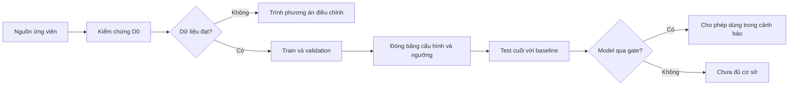
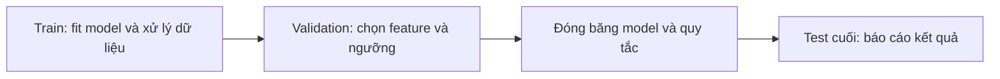

# AGTECH-01 — Kế hoạch dữ liệu và đánh giá AI

**Điều hướng:** [Các cổng kiểm chứng](#section-1) · [1. Nguồn ứng viên và mức độ xác minh](#section-2) · [2. Cổng kiểm chứng dữ liệu D0](#section-3) · [3. Hợp đồng dữ liệu](#section-4) · [4. Tập dữ liệu và feature](#section-5) · [5. Thiết kế đánh giá](#section-6) · [6. Độ tin cậy và giới hạn](#section-7) · [7. Bất thường và Risk Engine](#section-8) · [8. Sổ điểm chưa chốt](#section-9)

Phiên bản 1.1 — 20/11/2026. Đây là kế hoạch nghiên cứu và kiểm chứng; chưa có bộ dữ liệu hoặc kết quả huấn luyện được nghiệm thu.

## Các cổng kiểm chứng

| Nội dung | Tóm tắt |
| --- | --- |
| Dữ liệu | D0: quyền dùng, lịch sử, độ trễ, khả năng cập nhật |
| Mô hình | So với baseline trên cùng dữ liệu và horizon |
| Rủi ro | Ngưỡng chọn trước test; đánh giá cảnh báo riêng |
| Hiển thị | Có nguồn, độ cũ và căn cứ đánh giá |
| Khi không đạt | Chưa đủ cơ sở; ghi rõ phần chưa nghiệm thu |

> **Cách đọc trạng thái:** Đã chốt = được xác nhận; Đề xuất = phương án thiết kế; Cần kiểm chứng = chưa có bằng chứng đạt. Sơ đồ mô tả thiết kế mục tiêu, không chứng nhận chức năng đã triển khai.

## 1. Nguồn ứng viên và mức độ xác minh

| Nhóm | Nguồn | Đã quan sát | Cần kiểm chứng |
|---|---|---|---|
| Giá nội địa | [AgroInfo, báo cáo tuần 16/2025](https://thitruongnongsan.gov.vn/images/2013/DANGNHAP/VnSAT_Ca%20phe/2025/Tu%E1%BA%A7n/B%C3%A1o%20c%C3%A1o%20C%C3%A0%20ph%C3%AA%20s%E1%BB%91%2016_2025.pdf) | Mẫu bảng giá nhân xô theo địa bàn, VNĐ/kg, ngày trong tuần | Chuỗi liên tục, ngày cụ thể trong bảng, độ trễ công bố, quyền sử dụng và độ ổn định trích xuất |
| Giá nội địa bổ sung | [Giacaphe](https://giacaphe.com/gia-ca-phe-noi-dia/) | Có trang giá; lịch sử có bước đăng nhập | Khả năng tải lịch sử, điều kiện sử dụng và API; chưa coi là nguồn sẵn sàng |
| Giá quốc tế | [World Bank Commodity Markets](https://www.worldbank.org/en/research/commodity-markets) | Có dữ liệu giá hàng hóa lịch sử theo tháng | Chọn chuỗi cà phê phù hợp, đơn vị, lịch công bố và phiên bản dữ liệu |
| Thời tiết | [Open-Meteo Historical Weather API](https://open-meteo.com/en/docs/historical-weather-api) | Có API lịch sử theo tọa độ | Tọa độ đại diện, biến, múi giờ, độ trễ và điều kiện sử dụng tại thời điểm triển khai |

Các kết quả trên là khảo sát sơ bộ, không chứng minh đủ lịch sử để dự báo bảy ngày. PDF có thể chứa chênh lệch giữa tường thuật và bảng; phải lưu quy tắc chọn và kiểm tra chéo. Không vượt bước đăng nhập hoặc coi dữ liệu đọc được là mặc nhiên được phép tái phân phối.

## 2. Cổng kiểm chứng dữ liệu D0

Lập danh mục tài liệu/endpoint, lưu mẫu thô và thống kê một chuỗi ứng viên. Báo cáo D0 phải có: khoảng thời gian; số ngày có giá; tỷ lệ và độ dài khoảng trống; số nguồn và xung đột; loại giá/chất lượng; địa bàn; lịch xuất bản; quyền sử dụng; cách thu thập; mẫu lỗi trích xuất.

Đặc biệt phân biệt ngày giá được quan sát và ngày báo cáo xuất bản. Nếu giá thứ Hai chỉ công bố trong báo cáo cuối tuần, backtest không được dùng giá đó từ thứ Hai. Nguồn lịch sử có thể đủ đánh giá hồi cứu nhưng không đáp ứng cập nhật vận hành hằng ngày. Cần chứng minh riêng hai khả năng này.

| Quyết định sau D0 | Cách xác lập |
|---|---|
| Mặt hàng và địa bàn | Chọn chuỗi nhất quán, có thể truy vết; trình lại nếu phải đổi mặt hàng |
| Lịch sử tối thiểu | Dựa vào số mẫu huấn luyện, validation/test, khoảng trống và khả năng phủ chế độ thị trường; chưa tự ấn định số tháng |
| Ngưỡng quá cũ | Dựa vào nhịp công bố thật và nhu cầu sử dụng, có kiểm tra ngày nghỉ |
| Quyền sử dụng | Ghi căn cứ cho thu thập, lưu trữ và hiển thị; nguồn không rõ chưa qua D0 |
| Khả năng cập nhật | Chạy thử connector theo lịch và ghi độ trễ; nhập tệp không thay bằng chứng tự động |

### Từ nguồn đến kết quả

## 3. Hợp đồng dữ liệu

| Nhóm trường | Nội dung cần giữ | Mục đích |
| --- | --- | --- |
| Định danh | Mặt hàng, loại/chất lượng, địa bàn nguồn và mã chuẩn | Giữ chuỗi giá tương đương |
| Giá trị | Giá và đơn vị | Chuẩn hóa và kiểm tra |
| Thời gian | Ngày quan sát, thời điểm công bố nếu biết, thời điểm thu thập | Tránh dùng thông tin tương lai |
| Truy vết | Nguồn, liên kết tài liệu, phiên bản, trạng thái kiểm tra | Đối chiếu và tái lập |

Giữ bản gốc bất biến; chuẩn hóa thành lớp riêng. Không suy diễn địa bàn lịch sử bằng tên hiện tại mà thiếu bảng ánh xạ theo thời kỳ. Nếu không biết ngày công bố, ghi chưa biết và dùng mốc bảo thủ có bằng chứng cho backtest; không mặc định bằng ngày quan sát.

Kiểm tra giá dương, kiểu số, đơn vị, ngày, trùng khóa và giá xung đột. Không tự lấy trung bình các nguồn khác chất lượng. Sửa dữ liệu tạo phiên bản và dấu vết; bất thường thống kê chỉ là cờ cần kiểm tra, không tự xóa quan sát.

Thời tiết giữ tọa độ, ngày/giờ, đơn vị và nguồn sản phẩm. Giá quốc tế giữ loại hàng, tiền tệ và đơn vị. Không nội suy dữ liệu tháng thành quan sát ngày thật. Khi dùng làm feature, chỉ truyền giá trị mới nhất đã được công bố ở mốc dự báo và giữ tuổi dữ liệu.

## 4. Tập dữ liệu và feature

Đề xuất mô hình khởi đầu: baseline giữ nguyên giá gần nhất; một mô hình cây tăng cường với lag và thống kê cửa sổ. Thuật toán/thư viện cụ thể được chọn sau thử nghiệm; chưa có lý do bắt buộc LSTM.

Feature ứng viên: giá quá khứ, thay đổi giá, trung bình cửa sổ, ngày trong tuần và mùa vụ. Cửa sổ chỉ dùng dữ liệu khả dụng trước mốc dự báo. Tạo lịch ngày đầy đủ, giữ nhãn thiếu và khoảng cách từ quan sát gần nhất; nếu điền giá để tạo feature thì giữ cờ điền, không điền target để tính metric.

Đề xuất dự báo trực tiếp theo từng horizon h=1…7. Cần kiểm tra số mẫu riêng cho từng horizon. Thời tiết, giá quốc tế chỉ thêm sau kiểm tra ablation trên validation; không đưa vào chỉ để đủ số nhóm nguồn.

## 5. Thiết kế đánh giá

Chia train → validation → test theo thời gian; test cuối giữ kín đến khi đóng băng model và cấu hình. Dùng nhiều mốc validation cuốn chiếu nếu đủ dữ liệu. Ở ranh giới tập, loại các mẫu huấn luyện có target nằm sang giai đoạn đánh giá. Mọi scaler, imputing, chọn feature và ngưỡng đều fit trong dữ liệu huấn luyện tương ứng.

Ở mỗi mốc, mô phỏng đúng dữ liệu đã công bố lúc đó. Baseline và model dùng cùng mốc, cùng target có quan sát và cùng quy tắc thiếu dữ liệu. Báo cáo số mẫu và tỷ lệ bao phủ từng horizon; nếu ngày nghỉ không có ground truth thì ghi rõ không đánh giá được phần đó.

| Chỉ số | Vai trò |
|---|---|
| MAE theo h=1…7 | Chính; đơn vị VNĐ/kg |
| MAE tổng hợp | Đề xuất trung bình đều MAE các horizon đủ điều kiện; không che horizon thiếu mẫu |
| RMSE | Bổ sung để thấy sai số lớn |
| MAPE | Bổ sung khi target dương và phù hợp; công bố xử lý target không hợp lệ |
| Độ đúng chiều | Chẩn đoán bổ sung, chưa là gate bắt buộc |
| Coverage dữ liệu | Số target thực dùng/target dự kiến; kèm khoảng trống và độ trễ |

Mức cải thiện tương đối = (MAE_baseline − MAE_model) / MAE_baseline. Nếu baseline bằng 0, báo chênh lệch tuyệt đối và không chia cho 0. Ngưỡng cải thiện tối thiểu, giới hạn suy giảm từng horizon và số mẫu tối thiểu được xác lập trước khi mở test. Nếu chỉnh sau xem test, phải có giai đoạn kiểm thử mới.

### Thứ tự đánh giá

## 6. Độ tin cậy và giới hạn

Mọi dự báo hiển thị nguồn, tuổi dữ liệu, thời điểm tạo, model/version và kết quả đánh giá liên quan. Không tự gắn tỷ lệ “tin cậy 95%” khi chưa hiệu chuẩn. Đề xuất nghiên cứu khoảng dự báo bằng sai số validation theo horizon; đánh giá độ bao phủ và độ rộng trên test trước khi hiển thị. Nếu chưa đủ cơ sở cho khoảng dự báo, nêu rõ và trình bày sai số lịch sử thay vì một xác suất tự đặt.

Sai số lịch sử không bảo đảm sai số tương lai. Phân tích liên hệ thời tiết/giá quốc tế là tương quan, không phải kết luận nhân quả.

## 7. Bất thường và Risk Engine

Đề xuất phát hiện bất thường bằng độ lệch của biến động giá so với cửa sổ lịch sử chỉ gồm quá khứ; chọn phương pháp và ngưỡng qua kiểm tra mẫu. Đánh giá riêng các lỗi nhập liệu, cú sốc giá thật và ảnh hưởng khoảng nghỉ. Chưa có nhãn thì công bố kiểm tra thủ công và hạn chế, không tự báo accuracy.

Với P0 là giá quan sát hợp lệ gần nhất và F1…F7 là dự báo hợp lệ:

`drop_pct = max(0, (P0 - min(F1,…,F7)) / P0 × 100)`

| Điều kiện | Trạng thái | Ý nghĩa |
| --- | --- | --- |
| Thiếu điều kiện dữ liệu/model hoặc thiếu bảy dự báo | Chưa đủ cơ sở | Không phân loại LOW/MEDIUM/HIGH |
| drop_pct < T1 | LOW | Mức giảm dự báo dưới ngưỡng thứ nhất |
| T1 ≤ drop_pct < T2 | MEDIUM | Mức giảm dự báo giữa hai ngưỡng |
| drop_pct ≥ T2 | HIGH | Mức giảm dự báo từ ngưỡng thứ hai |

**T1/T2 chờ kiểm chứng; 0 < T1 < T2.** Đây là phân loại theo quy tắc, không phải xác suất.

Chỉ phân loại khi dữ liệu đủ mới, P0 hợp lệ, đủ bảy dự báo và model đã qua gate. Ngày không có ground truth khiến đánh giá mức giảm thực tế trong cả kỳ bị thiếu; báo coverage và không xem min của một tập ngày thiếu là min thật của cả bảy ngày.

Đánh giá cảnh báo bằng số lần phát, tỷ lệ cảnh báo có thể đối chiếu, false alarm/miss theo định nghĩa đã đóng băng và thời gian báo trước. Không chỉ dùng MAE để kết luận cảnh báo hữu ích. Ngưỡng rủi ro chọn trên train/validation cùng ý nghĩa nghiệp vụ; không tối ưu trên test cuối.

## 8. Sổ điểm chưa chốt

| Mã | Nội dung | Thời điểm chốt |
|---|---|---|
| D-01 | Nguồn, mặt hàng, địa bàn và quyền sử dụng | Kết thúc D0 |
| D-02 | Lịch cập nhật, độ cũ tối đa, lịch sử và mẫu tối thiểu | Sau profiling, trước training chính thức |
| D-03 | Model, feature, cách xử lý thiếu | Qua validation |
| D-04 | Ngưỡng cải thiện và bảo vệ từng horizon | Trước mở test |
| D-05 | T1/T2 và tiêu chí đánh giá cảnh báo | Trước mở test |
| D-06 | Khoảng dự báo và cách thể hiện độ tin cậy | Sau calibration, trước nghiệm thu UI dự báo |

Lưu snapshot dữ liệu, cấu hình, mã nguồn/phiên bản, báo cáo metric và quyết định cho phép sử dụng model. Nếu không đạt, giữ trạng thái chưa đủ cơ sở và trình phương án điều chỉnh; không thay bằng kết quả giả.
