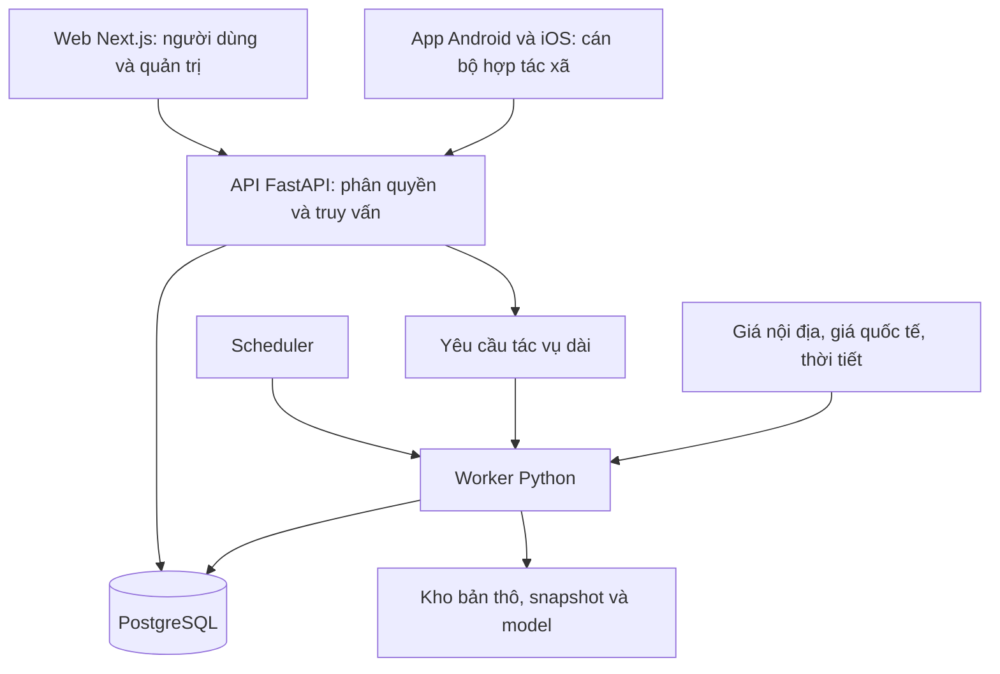
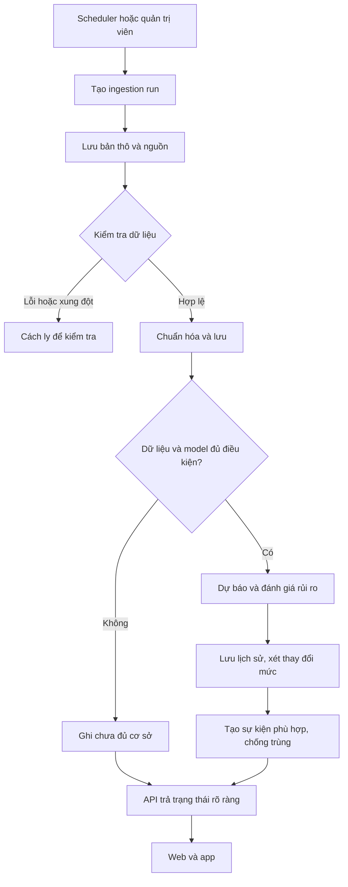
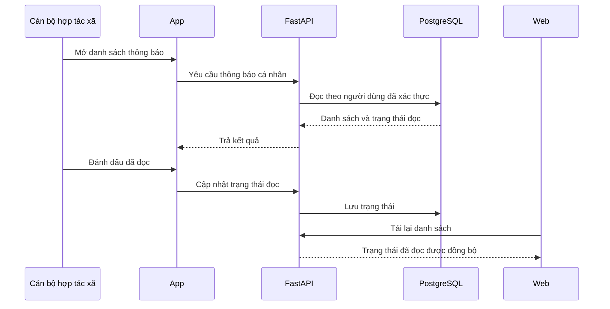

# AGTECH-01 — Thiết kế hệ thống

**Điều hướng:** [Trạng thái quyết định](#section-1) · [Sơ đồ kiến trúc mục tiêu](#section-2) · [1. Thành phần](#section-3) · [2. Luồng dữ liệu](#section-4) · [3. Mô hình dữ liệu đề xuất](#section-5) · [4. API dự kiến](#section-6) · [5. Web và app](#section-7) · [6. Xác thực và vận hành](#section-8) · [7. Các quyết định còn cần kiểm chứng](#section-9)

Phiên bản 1.1 — 20/11/2026. Next.js, FastAPI và PostgreSQL đã được chọn. Các chi tiết kiến trúc còn lại trong tài liệu là phương án đề xuất, cần kiểm chứng khi triển khai.

## Trạng thái quyết định

| Nội dung | Tóm tắt |
| --- | --- |
| Đã chốt | Next.js + FastAPI + PostgreSQL |
| Đã chốt | Web quản trị; app cho cán bộ hợp tác xã |
| Đề xuất | React Native/Expo, worker riêng, scheduler |
| Cần kiểm chứng | Build Android/iOS, xác thực, triển khai, tải thử |
| Trạng thái hiện tại | Backend /health; chức năng nghiệp vụ chưa triển khai |

> **Cách đọc trạng thái:** Đã chốt = được xác nhận; Đề xuất = phương án thiết kế; Cần kiểm chứng = chưa có bằng chứng đạt. Sơ đồ mô tả thiết kế mục tiêu, không chứng nhận chức năng đã triển khai.

## Sơ đồ kiến trúc mục tiêu

API phục vụ kết quả đã lưu; worker thực hiện tác vụ dài. Scheduler, worker và công nghệ app là phương án đề xuất.

## 1. Thành phần

| Thành phần | Trách nhiệm |
|---|---|
| Web Next.js | Giao diện cán bộ hợp tác xã và quản trị |
| App Android/iOS | Giao diện người dùng, xem dữ liệu, theo dõi và thông báo |
| API FastAPI | Xác thực, phân quyền, truy vấn thị trường, theo dõi và thông báo |
| Worker Python | Thu thập, kiểm tra, chuẩn hóa, inference, đánh giá rủi ro và tạo sự kiện |
| Scheduler | Kích hoạt tác vụ theo cấu hình nguồn, có khóa tránh chạy chồng |
| PostgreSQL | Dữ liệu chuẩn hóa, tài khoản, lịch sử và metadata |
| Kho tệp | Bản nguồn thô, snapshot, model artifact và báo cáo đánh giá |

Đề xuất app dùng React Native với Expo và TypeScript để cùng hệ sinh thái React với web. Đây chưa phải quyết định đã xác nhận; cần spike build Android/iOS, biểu đồ, đăng nhập và kết nối API trước khi chốt. Chia sẻ kiểu dữ liệu/API client khi phù hợp; không giả định có thể dùng nguyên giao diện web cho mobile.

Đề xuất backend dạng một ứng dụng chia module, worker chạy tiến trình riêng dùng cùng mã nghiệp vụ. Không chạy training hoặc ETL dài trong vòng đời HTTP request. Không cần tách AI thành microservice độc lập ở MVP.

## 2. Luồng dữ liệu

Model mới chỉ được chuyển sang trạng thái dùng vận hành sau báo cáo đánh giá và quyết định kích hoạt. Huấn luyện, đánh giá và dự báo vận hành là các tác vụ riêng.

## 3. Mô hình dữ liệu đề xuất

| Nhóm bảng | Nội dung và ràng buộc chính |
|---|---|
| users, sessions | Vai trò, trạng thái tài khoản, phiên đăng nhập và thu hồi |
| commodities, regions, series | Loại hàng, địa bàn, chất lượng/đơn vị; chuỗi không chỉ định danh bằng tên mặt hàng |
| sources, ingestion_runs, raw_assets | Nguồn, cấu hình lịch, trạng thái chạy, tài liệu thô và checksum |
| price_observations, observation_revisions | Ngày quan sát, giá, thời điểm công bố/thu thập, phiên bản và chất lượng |
| weather_observations, international_prices | Dữ liệu bổ sung có đơn vị, tọa độ/loại hàng, thời điểm khả dụng |
| data_quality_issues | Lỗi, xung đột, trạng thái xử lý và dấu vết người xử lý |
| model_versions, evaluations | Artifact, snapshot, cấu hình, metric, trạng thái đủ điều kiện |
| forecast_runs, forecast_points | Mốc dự báo, model, dữ liệu đến ngày nào; một điểm cho mỗi horizon 1–7 |
| anomaly_results, risk_assessments | Kết quả riêng biệt, phiên bản quy tắc, lý do và trạng thái |
| subscriptions | Khóa duy nhất user–series |
| notification_events, user_notifications | Sự kiện nghiệp vụ, người nhận và trạng thái đọc |
| audit_logs | Thao tác quản trị và thay đổi có ảnh hưởng |

Giá dùng số thập phân; không lưu phần trăm rủi ro như xác suất. Thời điểm lưu UTC, hiển thị rõ múi giờ; ngày quan sát là trường ngày độc lập. Đề xuất giữ lịch sử dự báo bất biến và chỉ đánh dấu kết quả bị thay thế/không còn hiện hành.

Khóa chống trùng cần bao gồm nguồn, chuỗi, ngày và phiên bản phù hợp. Hai giá xung đột cùng ngày không được âm thầm ghi đè. Tạo đánh giá và sự kiện trong giao dịch, kèm khóa duy nhất theo lần đánh giá và loại sự kiện để retry không gửi lặp.

## 4. API dự kiến

| Nhóm endpoint | Nội dung |
|---|---|
| /auth/login, /auth/logout, /auth/me | Quản lý phiên và danh tính |
| /series, /series/{id}/prices | Danh mục và lịch sử có phân trang/bộ lọc |
| /series/{id}/forecast | Dự báo hiện hành và trạng thái đủ điều kiện |
| /series/{id}/risk, /series/{id}/anomalies | Rủi ro và bất thường riêng |
| /subscriptions | Danh sách theo dõi của người gọi |
| /notifications | Thông báo cá nhân, đánh dấu đã đọc |
| /admin/sources, /admin/imports | Quản lý nguồn và nhập tệp |
| /admin/runs, /admin/models, /admin/quality-issues | Vận hành, đánh giá và kiểm tra dữ liệu |

Đường dẫn là đề xuất. Hợp đồng response dự báo phải chứa status, reasons, issued_at, data_as_of, model_version, points và evaluation_reference. Kết quả chưa đủ cơ sở trả trạng thái nghiệp vụ rõ ràng; lỗi hạ tầng trả mã lỗi phù hợp. Tác vụ dài trả job_id để theo dõi.

### Đồng bộ thông báo giữa các thiết bị

## 5. Web và app

Web người dùng gồm đăng nhập, tổng quan, chi tiết chuỗi, theo dõi và lịch sử thông báo. Web quản trị bổ sung nguồn, nhập tệp, chất lượng, tác vụ và model.

App gồm đăng nhập, tổng quan, chi tiết chuỗi, danh sách theo dõi và thông báo. Khi mở lại app, tải trạng thái mới. Đề xuất tải lại khi màn hình được mở và thao tác làm mới; chưa cần WebSocket hay SSE.

Thông báo lưu trên server. Đánh dấu đã đọc trên một thiết bị được phản ánh ở thiết bị khác khi đồng bộ. Mất mạng không xóa nội dung còn hiển thị nhưng phải ghi rõ trạng thái và thời điểm cập nhật; thao tác ghi thất bại cho thử lại có chống trùng.

## 6. Xác thực và vận hành

Đề xuất web dùng cookie phiên HttpOnly/Secure; mobile dùng thông tin phiên trong kho bảo mật của nền tảng. Phiên hết hạn hoặc bị thu hồi phải yêu cầu đăng nhập lại. Cách triển khai token/refresh cụ thể được kiểm chứng ở spike xác thực; không lưu bí mật trong mã nguồn hoặc log.

Đề xuất đóng gói API/worker/web bằng Docker; PostgreSQL và kho artifact có sao lưu. Môi trường phát triển, kiểm thử và triển khai tách cấu hình. Công cụ cloud, phiên bản thư viện và chi phí được chọn sau khảo sát, không cố định theo tên nhà cung cấp trong đề gốc.

Log gắn run_id/request_id và không chứa mật khẩu/token. Theo dõi tác vụ thất bại, tuổi dữ liệu, thời gian xử lý và số kết quả chưa đủ cơ sở. Kiểm thử phục hồi database và truy cập artifact tương ứng trước bàn giao.

## 7. Các quyết định còn cần kiểm chứng

- Spike công nghệ app và điều kiện build/cài đặt iOS/Android; không coi chạy web preview là kiểm thử iOS.
- Cách xác thực web/mobile và thu hồi phiên.
- Scheduler, cơ chế khóa tác vụ, kho artifact và quy mô lưu trữ.
- Thời gian đáp ứng mục tiêu và quy mô tải thử.
- Các quy tắc thông báo khi phục hồi từ trạng thái chưa đủ cơ sở trong tài liệu 02.

Các nội dung này là công việc thiết kế/kiểm chứng trong kế hoạch, không phải yêu cầu mở rộng chức năng đã được người dùng duyệt.
