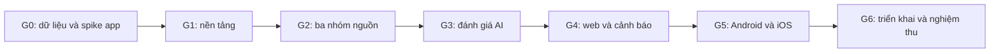

# AGTECH-01 — Kế hoạch triển khai theo giai đoạn

**Điều hướng:** [Mốc bàn giao](#section-1) · [Sơ đồ phụ thuộc giai đoạn](#section-2) · [1. Trình tự và đầu ra](#section-3) · [2. Công việc theo lát cắt có thể kiểm tra](#section-4) · [3. Các cổng quyết định](#section-5) · [4. Chiến lược kiểm thử](#section-6) · [5. Rủi ro tiến độ](#section-7) · [6. Gói bàn giao dự kiến](#section-8)

Phiên bản 1.1 — 20/11/2026. Thực hiện cá nhân, chưa có hạn chót cố định; kế hoạch dùng mốc đầu ra và điều kiện chuyển bước. Không tự cam kết số tuần khi chưa kiểm chứng dữ liệu và môi trường mobile.

## Mốc bàn giao

| Nội dung | Tóm tắt |
| --- | --- |
| G0 | Chứng minh tính khả thi dữ liệu và môi trường app |
| G1–G2 | Luồng dữ liệu đến web |
| G3–G4 | Đánh giá AI và luồng cảnh báo trên web |
| G5 | Hoàn thiện app Android/iOS |
| G6 | Triển khai, phục hồi và bằng chứng nghiệm thu |

> **Cách đọc trạng thái:** Đã chốt = được xác nhận; Đề xuất = phương án thiết kế; Cần kiểm chứng = chưa có bằng chứng đạt. Sơ đồ mô tả thiết kế mục tiêu, không chứng nhận chức năng đã triển khai.

## Sơ đồ phụ thuộc giai đoạn

Đây là thứ tự phụ thuộc, không phải cam kết thời lượng. Model không đạt tại G3 phải được báo cáo; không kích hoạt cảnh báo dự báo như đã đạt.

## 1. Trình tự và đầu ra

| Giai đoạn | Phụ thuộc | Công việc và đầu ra | Điều kiện hoàn thành |
|---|---|---|---|
| G0 — Kiểm chứng dữ liệu và môi trường | Không | Báo cáo D0, mẫu thô, profiling, nguồn/quyền sử dụng, thử build app hai nền tảng | Chốt được phương án dữ liệu khả thi và đường kiểm thử Android/iOS; ghi các giới hạn |
| G1 — Nền tảng và dữ liệu | G0 | Schema, đăng nhập/phân quyền, nhập tệp, một connector, dashboard lịch sử đầu tiên | Luồng từ nguồn đến web có truy vết, retry không trùng, quyền đúng |
| G2 — Ba nhóm nguồn và chất lượng | G1 | Giá nội địa, giá quốc tế, thời tiết; lịch chạy, chất lượng, dữ liệu thiếu | Chứng minh nguồn thực, tuổi dữ liệu và trạng thái lỗi; không đồng nhất nhập tệp với tự động |
| G3 — Baseline và mô hình | G2 | Snapshot, split theo thời gian, baseline, model, validation, báo cáo test | Hoàn thành đánh giá; chỉ kích hoạt model nếu qua gate, nếu không báo cáo nguyên nhân |
| G4 — Rủi ro và luồng web đầy đủ | G3 | Risk Engine, bất thường, theo dõi, lịch sử và thông báo | Qua kịch bản chuyển trạng thái và chống lặp; thiếu dữ liệu xử lý đúng |
| G5 — App Android/iOS | G4; spike từ G0 | Tích hợp API, đăng nhập, dashboard, theo dõi, thông báo, mất mạng | Chạy và kiểm thử cả hai nền tảng, nhất quán với web |
| G6 — Triển khai và nghiệm thu | G5 | Web online, bản app thử nghiệm, sao lưu/phục hồi, hướng dẫn và bằng chứng | Hoàn tất ma trận nghiệm thu, công bố giới hạn và các mục chưa đạt |

Spike mobile ở G0 chỉ kiểm tra tính khả thi môi trường; chức năng app hoàn chỉnh triển khai sau luồng backend/web theo phạm vi đã chọn.

## 2. Công việc theo lát cắt có thể kiểm tra

| Mã | Công việc | Chặn bởi | Bằng chứng |
|---|---|---|---|
| T01 | Khảo sát một chuỗi giá và quyền dùng | Không | D0, mẫu và thống kê khoảng trống |
| T02 | Kiểm chứng build/kết nối app hai nền tảng | Không | Bản chạy tối thiểu và ghi môi trường |
| T03 | Đăng nhập và phân quyền đến màn hình web | T01 | FR-01 và kiểm thử API trái quyền |
| T04 | Nhập lịch sử đến biểu đồ web | T03 | FR-04/05/06 với dữ liệu có lỗi |
| T05 | Thu thập theo lịch đến biểu đồ có nguồn | T04 | FR-03, chạy lại và lỗi nguồn |
| T06 | Bổ sung giá quốc tế/thời tiết có truy vết | T05 | Ba nhóm nguồn, dữ liệu khả dụng theo thời điểm |
| T07 | Baseline và backtest tái lập | T06 | Snapshot, split, metric theo horizon |
| T08 | Model và quyết định đủ điều kiện | T07 | Báo cáo so baseline và phiên bản model |
| T09 | Dự báo hoặc trạng thái chưa đủ cơ sở trên web | T08 | FR-07/12 |
| T10 | Bất thường, rủi ro và lịch sử | T09 | FR-08/09, kiểm thử biên ngưỡng |
| T11 | Theo dõi và thông báo xuyên suốt | T10 | FR-10/11, không lặp sự kiện |
| T12 | App đăng nhập và dashboard | T02, T11 | Cùng dữ liệu trên web/Android/iOS |
| T13 | App theo dõi, thông báo và mất mạng | T12 | FR-14/15, đồng bộ đọc thông báo |
| T14 | Triển khai, phục hồi và bàn giao | T13 | Ma trận nghiệm thu và hướng dẫn |

Đây là backlog trong tài liệu, chưa tạo issue trên tracker. Khi triển khai, chia nhỏ thêm nếu một công việc không thể nghiệm thu trong một đợt làm việc rõ ràng.

## 3. Các cổng quyết định

| Điểm dừng | Hành động | Điều kiện tiếp tục |
| --- | --- | --- |
| Dữ liệu không đạt | Trình phương án nguồn/địa bàn hoặc thay đổi phạm vi | Có phương án được chấp thuận trước đổi mặt hàng/kỳ dự báo |
| Lịch sử đạt, cập nhật không đạt | Kiểm chứng đường cập nhật | Có bằng chứng nguồn đáp ứng nhịp vận hành |
| Model kém baseline | Phân tích validation; đánh giá lại hợp lệ | Qua gate mới bật cảnh báo; nếu không thì giữ chưa đủ cơ sở |
| Chưa kiểm thử được iOS | Ghi rõ điều kiện còn thiếu | Có bằng chứng iOS thực, không dùng ảnh Android thay thế |
| Thêm chức năng ngoài MVP | Ghi thay đổi phạm vi và tác động | Thống nhất thay đổi trước thêm backlog |

## 4. Chiến lược kiểm thử

Kiểm thử đơn vị tập trung vào biên ngưỡng rủi ro, thời điểm dữ liệu khả dụng và chuyển trạng thái thông báo. Kiểm thử tích hợp tập trung vào database, quyền, nhập dữ liệu, retry và lưu lịch sử. Kiểm thử đầu cuối kiểm tra các hành trình trên web và hai nền tảng app.

Kiểm thử AI dùng dữ liệu lịch sử thực với split theo thời gian; fixture tổng hợp chỉ kiểm tra hành vi phần mềm. Kiểm thử thủ công kiểm tra biểu đồ, nhãn nguồn/độ cũ, khả năng đọc trên màn hình nhỏ và thông báo lỗi.

Lưu ma trận: mã FR/NFR → ca kiểm thử → nền tảng → kết quả → bằng chứng → lỗi còn mở. Khi model đổi hoặc nguồn đổi schema, chạy lại các kiểm tra bị ảnh hưởng.

## 5. Rủi ro tiến độ

| Rủi ro | Dấu hiệu | Hành động |
|---|---|---|
| Lịch sử thiếu hoặc bị giới hạn truy cập | Không tạo được chuỗi nhất quán | Xử lý ngay G0, không chờ xây xong giao diện |
| PDF thay cấu trúc | Sai ngày, sai đơn vị hoặc thiếu dòng | Giữ mẫu regression và cách ly kết quả không đạt |
| Leakage | Metric quá tốt nhưng dùng ngày công bố sai | Kiểm tra as-of và tạo lại dataset |
| Mô hình kém baseline | MAE không cải thiện | Giữ báo cáo trung thực, xem lại dữ liệu và tính khả thi |
| App hai nền tảng tăng khối lượng | Build/cài đặt hoặc biểu đồ lỗi nền tảng | Spike sớm; quản trị chỉ trên web |
| Cá nhân làm quá nhiều nhánh | Chức năng dang dở không nghiệm thu | Hoàn thành từng lát cắt, giữ ngoài phạm vi như đã chốt |

## 6. Gói bàn giao dự kiến

- Mã nguồn, cấu hình mẫu và hướng dẫn dựng môi trường, không kèm bí mật.
- Web online, bản app có thể chạy/cài theo hình thức thử nghiệm được kiểm chứng; hướng dẫn cho cả hai nền tảng.
- Dữ liệu/snapshot được phép bàn giao, danh mục nguồn và điều kiện dùng; không tự đóng gói nguồn chưa được phép phân phối.
- Model artifact, báo cáo đánh giá, trạng thái được phép sử dụng và lịch sử cấu hình.
- Ma trận nghiệm thu, bằng chứng Android/iOS, kết quả sao lưu/phục hồi.
- Hướng dẫn quản trị, hướng dẫn người dùng và danh sách giới hạn còn lại.

Năm tài liệu hiện tại là đầu ra của giai đoạn lập kế hoạch. Các bản build, mô hình và bằng chứng trên là đầu ra tương lai của giai đoạn triển khai.
