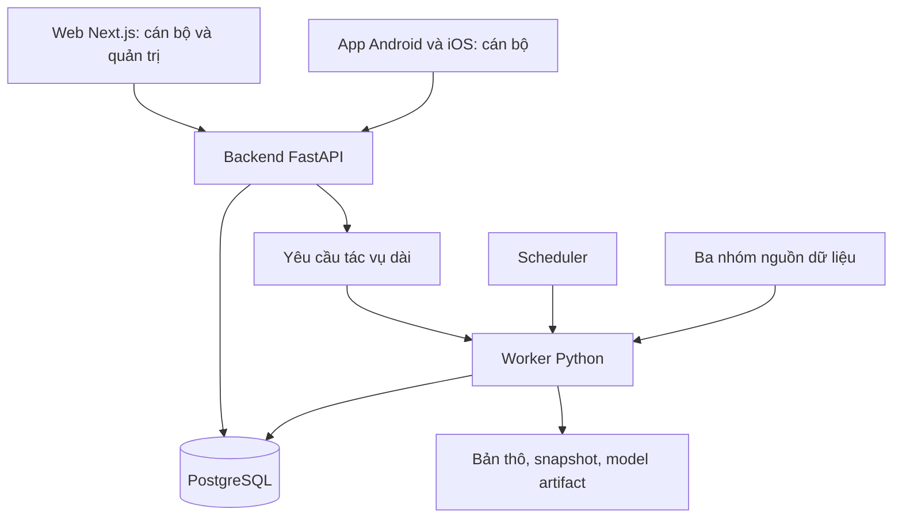
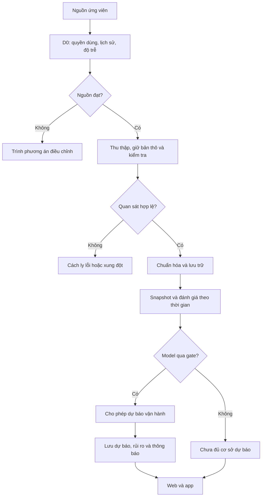
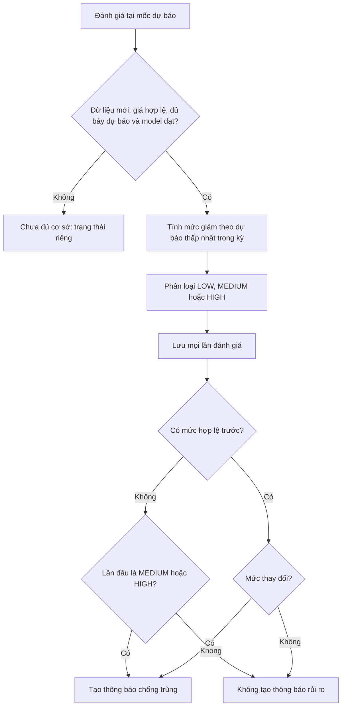

# AGTECH-01 — Đặc tả web và app theo dõi thị trường nông sản

| Thông tin | Giá trị |
|---|---|
| Phiên bản trình bày | 1.2 — 20/11/2026 |
| Issue gốc | https://github.com/phamvu65/agtech/issues/1 |
| Phạm vi | Q1–Q29 và ranh giới kiểm thử đã xác nhận |
| Mục đích cập nhật | Chi tiết hóa story để chia ticket; giữ phạm vi và mã truy vết |
| Mức sẵn sàng | Có thể bắt đầu kiểm chứng; các ngưỡng dữ liệu/AI chưa chốt |

> **Đã xác nhận** là yêu cầu/định hướng đã chốt. **Đề xuất** là phương án thiết kế. **Cần kiểm chứng** là điểm chưa có đủ bằng chứng để kết luận đạt. Các sơ đồ thể hiện thiết kế mục tiêu.

## Mục lục

- [1. Tổng quan — Problem Statement & Solution](#tong-quan)
- [2. Phạm vi MVP](#pham-vi)
- [3. User stories theo nhóm chức năng](#user-stories)
- [4. Quyết định triển khai — Implementation Decisions](#quyet-dinh)
- [5. Kiến trúc mục tiêu](#kien-truc)
- [6. Luồng dữ liệu và cổng kiểm chứng](#luong-du-lieu)
- [7. Rủi ro và thông báo](#canh-bao)
- [8. Tiêu chí nghiệm thu](#nghiem-thu)
- [9. Quyết định kiểm thử — Testing Decisions](#kiem-thu)
- [10. Điểm chưa chốt](#chua-chot)
- [11. Ngoài phạm vi — Out of Scope](#ngoai-pham-vi)
- [12. Ghi chú — Further Notes](#ghi-chu)

## 1. Tổng quan — Problem Statement & Solution

| Thuộc tính | Nội dung |
|---|---|
| Người dùng chính | Cán bộ hợp tác xã |
| Sản phẩm | Web + Android + iOS, dùng chung backend |
| Phạm vi thị trường | Một mặt hàng, một địa bàn; ưu tiên cà phê sau kiểm chứng |
| Dự báo | Từng ngày trong bảy ngày lịch tới |
| Công nghệ đã chọn | Next.js + Python/FastAPI + PostgreSQL |
| Quyền quyết định tiêu thụ | Thuộc người dùng |

### Vấn đề

Cán bộ hợp tác xã cần thông tin đáng tin cậy để tham khảo khi lập kế hoạch tiêu thụ nông sản. Giá, thời tiết và giá quốc tế phân tán ở nhiều nguồn, khác đơn vị, địa bàn và nhịp cập nhật. Theo dõi thủ công khó nhận biết xu hướng và phân biệt tín hiệu thị trường với dữ liệu lỗi hoặc quá cũ.

Người dùng cần truy cập trên web và điện thoại, thấy nguồn và thời điểm dữ liệu, dự báo ngắn hạn cùng giới hạn của nó, và được thông báo khi rủi ro giá giảm thay đổi. Quyết định tiêu thụ vẫn thuộc cán bộ hợp tác xã.

### Giải pháp

Xây dựng web và app Android/iOS dùng chung backend và dữ liệu. MVP tập trung một mặt hàng, ưu tiên cà phê nhân trong nước, đơn vị VNĐ/kg, tại một địa bàn được chọn sau kiểm chứng nguồn.

Hệ thống thu thập ba nhóm dữ liệu: giá nội địa, giá quốc tế và thời tiết; chuẩn hóa và lưu nguồn, thời điểm, chất lượng. Mô hình dự báo từng ngày trong bảy ngày lịch tới; chỉ dùng lịch sử giá là yêu cầu bắt buộc cho mô hình MVP. Dữ liệu bổ sung chỉ đưa vào khi đánh giá cho thấy hữu ích.

Dashboard hiển thị lịch sử, dự báo, cờ bất thường và mức rủi ro LOW/MEDIUM/HIGH. Rủi ro phản ánh mức giảm dự báo, không phải xác suất giảm. Khi chưa đủ dữ liệu hoặc mô hình chưa đạt, hiển thị chưa đủ cơ sở thay vì LOW. Web cung cấp chức năng người dùng và quản trị; app phục vụ cán bộ hợp tác xã. Thông báo được xem trong web/app, không yêu cầu push.

## 2. Phạm vi MVP

| Nhóm | Trong MVP | Giới hạn |
| --- | --- | --- |
| Dữ liệu | Giá nội địa, giá quốc tế, thời tiết | Model chỉ bắt buộc dùng lịch sử giá |
| Thu thập | Theo lịch khi nguồn hỗ trợ; nhập tệp có kiểm tra | Nhập tệp không được tính là thu thập tự động |
| Giá | Cà phê nhân trong nước, VNĐ/kg | Địa bàn, chất lượng và nguồn chốt qua kiểm chứng |
| AI | Dự báo, bất thường, phân loại rủi ro | Model phải qua đánh giá trước dùng cảnh báo |
| Web | Chức năng cán bộ và quản trị | Quản trị, nhập dữ liệu chỉ trên web |
| App | Chức năng cán bộ trên Android/iOS | Cần mạng; thông báo trong app khi mở |
| Bàn giao | Web online; app chạy được và kiểm thử hai nền tảng | Chưa bắt buộc phát hành lên store |

**Trạng thái:** phạm vi đã xác nhận; các sơ đồ dưới đây mô tả thiết kế mục tiêu. Chức năng nghiệp vụ chưa được coi là đã triển khai.

## 3. User stories theo nhóm chức năng

Phân nhóm dưới đây phục vụ chia ticket. **Mã US-01–US-35 được giữ nguyên**, không đánh lại số khi đổi nhóm. Phần A là chức năng sản phẩm; phần B là yêu cầu xuyên nền tảng, công việc kỹ thuật và bằng chứng bàn giao.

| Trường | Cách sử dụng khi chia ticket |
|---|---|
| Nhu cầu và giá trị | Xác định hành vi người dùng cần nhận được |
| FR/NFR | Truy ngược về yêu cầu và tiêu chí hệ thống ở mục 8 |
| Điều kiện hoàn thành | Cơ sở viết acceptance criteria quan sát được |
| Phụ thuộc đề xuất | Gợi ý thứ tự; không phải blocking link đã tạo trên tracker |

**Một story không mặc nhiên bằng một ticket.** Có thể gộp các story tạo một hành trình hoàn chỉnh hoặc chia một story thành các lát cắt có thể kiểm tra. Không chia ticket chỉ theo tầng database/API/UI. Phụ thuộc phải được rà soát theo lát cắt thực tế; các triển khai nền tảng có thể dùng chung để tránh vòng phụ thuộc.

Các điều kiện hoàn thành bên dưới diễn giải phạm vi và FR/NFR hiện có. Các lựa chọn về cấp tài khoản, cơ chế phiên, thông báo khôi phục, thuật toán và ngưỡng vẫn giữ trạng thái đề xuất/chờ kiểm chứng ở mục 4 và 10.

### A1. Tài khoản và quyền

**Loại:** Chức năng sản phẩm. **Vai trò:** Cán bộ hợp tác xã / quản trị viên.

| Mã | Nhu cầu | Giá trị |
|---|---|---|
| US-01 | **cán bộ hợp tác xã:** đăng nhập trên web hoặc app | truy cập thông tin và danh sách theo dõi của mình. |
| US-23 | **quản trị viên:** quản lý tài khoản và quyền truy cập | duy trì đúng vai trò sử dụng. |

**Căn cứ chia ticket và nghiệm thu**

| Mã | FR/NFR | Điều kiện hoàn thành | Phụ thuộc đề xuất |
|---|---|---|---|
| US-01 | FR-01 | Tài khoản hợp lệ đăng nhập được trên web/app; tài khoản vô hiệu bị chặn; đăng xuất kết thúc phiên. | Hợp đồng danh tính và xác thực |
| US-23 | FR-01 | Chỉ quản trị viên được quản lý tài khoản; gọi trực tiếp API bằng quyền cán bộ bị từ chối. | US-01; ma trận quyền |

### A2. Theo dõi thị trường

**Loại:** Chức năng sản phẩm. **Vai trò:** Cán bộ hợp tác xã.

| Mã | Nhu cầu | Giá trị |
|---|---|---|
| US-02 | xem giá thu mua gần nhất cùng đơn vị và loại hàng | hiểu đúng giá tham khảo. |
| US-03 | biết địa bàn và chất lượng hàng theo nguồn | tránh so sánh giá không tương đương. |
| US-04 | xem giá lịch sử theo thời gian | nhận biết diễn biến thị trường. |
| US-05 | thấy ngày thiếu giá | không nhầm dữ liệu điền thêm là giao dịch thực. |
| US-06 | thấy nguồn, ngày quan sát và thời điểm cập nhật | đánh giá độ mới của thông tin. |

**Căn cứ chia ticket và nghiệm thu**

| Mã | FR/NFR | Điều kiện hoàn thành | Phụ thuộc đề xuất |
|---|---|---|---|
| US-02 | FR-02, FR-06 | Có giá thì hiển thị giá, VNĐ/kg và loại hàng; không có giá thì hiển thị trạng thái rỗng. | US-32; US-24/25 → US-26 |
| US-03 | FR-02, FR-05 | Mỗi chuỗi gắn địa bàn và chất lượng theo nguồn; không trộn chuỗi không tương đương. | US-32; hợp đồng dữ liệu |
| US-04 | FR-06 | Lọc khoảng thời gian trả đúng các quan sát và thứ tự ngày; không tạo quan sát giả. | US-02, US-03 |
| US-05 | FR-05, FR-06 | Ngày thiếu được đánh dấu; biểu đồ không thể hiện giá điền như giá quan sát thật. | US-04, US-26 |
| US-06 | FR-06, NFR-01, NFR-02 | Hiển thị nguồn, ngày quan sát và thời điểm cập nhật; phân biệt thời điểm công bố/thu thập. | US-02; metadata nguồn |

### A3. Dự báo, bất thường và rủi ro

**Loại:** Chức năng sản phẩm. **Vai trò:** Cán bộ hợp tác xã.

| Mã | Nhu cầu | Giá trị |
|---|---|---|
| US-07 | xem dự báo cho từng ngày trong bảy ngày lịch tới | tham khảo kế hoạch tiêu thụ. |
| US-08 | biết thời điểm tạo dự báo và dữ liệu được dùng đến ngày nào | tránh sử dụng dự báo cũ như hiện hành. |
| US-09 | xem sai số lịch sử và giới hạn dự báo | hiểu mức độ tin cậy có căn cứ. |
| US-10 | thấy trạng thái chưa đủ cơ sở cùng lý do | không hiểu nhầm thiếu dữ liệu thành rủi ro thấp. |
| US-11 | thấy cờ bất thường trên giá quan sát | chú ý đến điểm cần kiểm tra. |
| US-12 | phân biệt bất thường dữ liệu với rủi ro giá giảm | diễn giải đúng tín hiệu. |
| US-13 | xem mức LOW/MEDIUM/HIGH và căn cứ phân loại | tham khảo trước khi quyết định bán. |

**Căn cứ chia ticket và nghiệm thu**

| Mã | FR/NFR | Điều kiện hoàn thành | Phụ thuộc đề xuất |
|---|---|---|---|
| US-07 | FR-07 | Khi đủ điều kiện trả bảy ngày lịch sau mốc dự báo; thiếu điều kiện không công bố dự báo hợp lệ. | US-30, US-31, US-33; gate dữ liệu/model |
| US-08 | FR-07, FR-12 | Dự báo có thời điểm tạo, dữ liệu đến ngày nào và phiên bản; kết quả cũ không giả là hiện hành. | US-07, US-31 |
| US-09 | FR-07, NFR-01 | Có tham chiếu sai số theo horizon, số mẫu và giới hạn; không tự gắn phần trăm tin cậy chưa hiệu chuẩn. | US-30, US-33; D-06 |
| US-10 | FR-07, FR-09 | Dữ liệu thiếu/quá cũ hoặc model chưa đạt có lý do; không gán LOW thay cho chưa đủ cơ sở. | Gate dữ liệu/model; D-02 |
| US-11 | FR-08 | Cờ có ngày, giá, phương pháp/phiên bản và căn cứ; kiểm tra mẫu lỗi và biến động thật. | US-04, US-26; chọn phương pháp bất thường |
| US-12 | FR-08, FR-09 | Bất thường và rủi ro có nhãn riêng; một cờ bất thường không tự chuyển rủi ro thành HIGH. | US-11, US-13 |
| US-13 | FR-09 | Phân loại theo giá dự báo thấp nhất so với giá mới nhất; kiểm tra sát hai ngưỡng và đầu vào không hợp lệ. | US-07, US-10; D-05 |

### A4. Theo dõi, lịch sử và thông báo

**Loại:** Chức năng sản phẩm. **Vai trò:** Cán bộ hợp tác xã.

| Mã | Nhu cầu | Giá trị |
|---|---|---|
| US-14 | đăng ký hoặc bỏ theo dõi mặt hàng–địa bàn | quản lý thông tin quan tâm. |
| US-15 | danh sách theo dõi nhất quán trên web và app | tiếp tục công việc giữa các thiết bị. |
| US-16 | nhận thông báo khi mức rủi ro thay đổi | biết có diễn biến mới. |
| US-17 | tránh nhận lặp cùng cảnh báo HIGH mỗi ngày | không bỏ qua thông báo hữu ích. |
| US-18 | xem lịch sử dự báo và đánh giá rủi ro | hiểu thông tin đã thay đổi ra sao. |
| US-19 | đọc và đánh dấu thông báo trên web/app | quản lý những nội dung đã xem. |

**Căn cứ chia ticket và nghiệm thu**

| Mã | FR/NFR | Điều kiện hoàn thành | Phụ thuộc đề xuất |
|---|---|---|---|
| US-14 | FR-10 | Thêm/bỏ theo dõi phạm vi hợp lệ; thao tác không sửa theo dõi của người khác và không tạo trùng. | US-01, US-03 |
| US-15 | FR-10, FR-14 | Thay đổi trên một nền tảng xuất hiện trên nền tảng khác khi tải lại từ backend. | US-14; API dùng chung |
| US-16 | FR-11 | Lần đầu MEDIUM/HIGH có thông báo, LOW không có; đổi mức lên hoặc xuống tạo sự kiện phù hợp. | US-13, US-14; lịch sử mức rủi ro |
| US-17 | FR-11 | HIGH → HIGH nhiều lần và retry cùng lần chạy không tạo thông báo lặp. | US-16; khóa chống trùng sự kiện |
| US-18 | FR-12 | Tra được dự báo và đánh giá đã lưu; đổi model không sửa ngược kết quả công bố. | US-07, US-13, US-31 |
| US-19 | FR-11, FR-14 | Chỉ thấy thông báo của mình; trạng thái đọc đồng bộ web/app sau tải lại. | US-01, US-16 |

### A5. Quản trị dữ liệu và vận hành

**Loại:** Chức năng sản phẩm. **Vai trò:** Quản trị viên.

| Mã | Nhu cầu | Giá trị |
|---|---|---|
| US-24 | quản lý nguồn và lịch thu thập | cập nhật dữ liệu phù hợp nhịp công bố. |
| US-25 | nhập tệp theo mẫu | khởi tạo hoặc bổ sung lịch sử khi cần. |
| US-26 | xem các dòng hợp lệ, lỗi, trùng và xung đột | kiểm soát dữ liệu nhập. |
| US-27 | truy vết bản nguồn và thay đổi dữ liệu | kiểm tra sai lệch. |
| US-28 | chạy lại tác vụ thất bại mà không nhân đôi dữ liệu | khôi phục vận hành. |
| US-29 | theo dõi trạng thái, thời gian và lỗi từng lần chạy | biết hệ thống đang hoạt động ra sao. |
| US-30 | xem kết quả đánh giá model so với baseline | quyết định model có đủ điều kiện sử dụng. |
| US-31 | giữ phiên bản model và dữ liệu gắn với dự báo | tái kiểm tra kết quả đã công bố. |

**Căn cứ chia ticket và nghiệm thu**

| Mã | FR/NFR | Điều kiện hoàn thành | Phụ thuộc đề xuất |
|---|---|---|---|
| US-24 | FR-03, FR-13 | Nguồn có lịch và lần chạy; lưu thời gian, kết quả, lỗi; có bằng chứng cập nhật tự động. | US-32; hợp đồng nguồn |
| US-25 | FR-04 | Có mẫu nhập và nguồn/người nhập; nhận tệp tạo kết quả xử lý kiểm tra được. | US-23; hợp đồng dữ liệu |
| US-26 | FR-04, FR-05 | Báo số dòng hợp lệ/lỗi/trùng/xung đột; lỗi không âm thầm vào chuỗi dùng huấn luyện. | US-24 hoặc US-25; quy tắc chất lượng |
| US-27 | FR-05, NFR-01 | Từ quan sát tìm được nguồn/bản gốc/lần nhập; sửa có phiên bản và dấu vết. | US-26; lưu bản thô |
| US-28 | FR-03, FR-13, NFR-04 | Chạy lại tác vụ thất bại không nhân đôi dữ liệu; lỗi còn tồn tại vẫn được báo đúng. | US-24, US-26; khóa chống trùng |
| US-29 | FR-13 | Xem trạng thái, thời gian, lỗi và số bản ghi theo run; lỗi nguồn không hiển thị thành công. | US-24/25; định danh lần chạy |
| US-30 | FR-07, FR-13 | Model và baseline dùng cùng target/mốc; có MAE từng horizon và quyết định qua/không qua gate. | US-32, US-33; D-04 |
| US-31 | FR-12, NFR-01 | Kết quả gắn snapshot, model/version và cấu hình; truy xuất được sau thay model. | Hợp đồng version/snapshot; US-27 |

### B1. Mobile và hành vi kết nối

**Loại:** Yêu cầu xuyên nền tảng. **Vai trò:** Cán bộ hợp tác xã.

| Mã | Nhu cầu | Giá trị |
|---|---|---|
| US-20 | biết khi mất mạng và có thể thử lại | không nhầm thao tác thất bại là thành công. |
| US-21 | dữ liệu còn trên màn hình có thời điểm cập nhật | nhận biết dữ liệu cũ. |
| US-22 | dùng app trên Android hoặc iOS | truy cập bằng điện thoại của mình. |

**Căn cứ chia ticket và nghiệm thu**

| Mã | FR/NFR | Điều kiện hoàn thành | Phụ thuộc đề xuất |
|---|---|---|---|
| US-20 | FR-15 | Mất mạng có trạng thái và thử lại; thao tác ghi chưa được server xác nhận không báo thành công. | Luồng app và API; US-22 |
| US-21 | FR-15, NFR-02 | Dữ liệu còn trên màn hình khi mất mạng ghi thời điểm cập nhật, không thể hiện là dữ liệu mới. | US-06, US-08, US-20 |
| US-22 | FR-14 | Đăng nhập, dashboard, theo dõi, thông báo chạy trên Android và iOS; có bằng chứng phiên bản/nền tảng. | Spike môi trường; luồng web/API tương ứng |

### B2. Kiểm chứng dữ liệu và đánh giá AI

**Loại:** Công việc kỹ thuật hỗ trợ triển khai. **Vai trò:** Người thực hiện đồ án.

| Mã | Nhu cầu | Giá trị |
|---|---|---|
| US-32 | kiểm chứng nguồn, lịch sử và quyền sử dụng trước huấn luyện | xác định tính khả thi thực tế. |
| US-33 | đánh giá theo thời gian và từng horizon | phát hiện sai số hoặc rò rỉ thông tin tương lai. |
| US-35 | công bố cả trường hợp model không đạt | báo cáo phản ánh đúng kết quả thực nghiệm. |

**Căn cứ chia ticket và nghiệm thu**

| Mã | FR/NFR | Điều kiện hoàn thành | Phụ thuộc đề xuất |
|---|---|---|---|
| US-32 | FR-02, FR-03, NFR-02 | D0 ghi quyền dùng, số mẫu, khoảng trống, địa bàn/chất lượng, độ trễ và đường cập nhật. | Không; là công việc kiểm chứng đầu vào |
| US-33 | FR-07, NFR-02 | Split theo thời gian; chỉ dùng thông tin đã công bố; tách target vượt ranh giới; báo mẫu theo horizon. | US-32; snapshot có thời điểm khả dụng |
| US-35 | FR-07, FR-09 | Báo cáo cả thất bại; model không đạt không kích hoạt cảnh báo dự báo như đã đạt. | US-30, US-33; kết quả gate cuối |

### B3. Bằng chứng bàn giao

**Loại:** Yêu cầu nghiệm thu. **Vai trò:** Người thực hiện đồ án.

| Mã | Nhu cầu | Giá trị |
|---|---|---|
| US-34 | lưu bằng chứng kiểm thử web, Android và iOS | chứng minh đầu ra hoạt động trên các nền tảng đã cam kết. |

**Căn cứ chia ticket và nghiệm thu**

| Mã | FR/NFR | Điều kiện hoàn thành | Phụ thuộc đề xuất |
|---|---|---|---|
| US-34 | FR-14, FR-15 | Lưu ca kiểm thử, kết quả, nền tảng và phiên bản web/Android/iOS; không dùng ảnh Android thay iOS. | Các hành trình cần nghiệm thu; US-22 |

### Quy tắc chuyển sang ticket

| Bước | Đầu ra cần có |
|---|---|
| 1. Chọn hành trình | Chỉ rõ US được bao phủ và người dùng nhận được gì |
| 2. Chốt phạm vi | Bao gồm, ngoài phạm vi, nền tảng cần hỗ trợ |
| 3. Viết nghiệm thu | Given/When/Then hoặc checklist, có ca lỗi/quyền/thiếu dữ liệu phù hợp |
| 4. Khai báo blocker | Chỉ blocker thực sự chặn ticket; dùng ID ticket sau khi tạo |
| 5. Chỉ ra bằng chứng | Test API, backtest hoặc hành trình web/Android/iOS phù hợp |
| 6. Kiểm tra sẵn sàng | Không tự đặt ngưỡng chưa chốt; ticket triển khai phụ thuộc gate chưa đạt phải bị chặn |

Chưa tạo ticket trong lần chỉnh spec này. Các mã D-02, D-04, D-05, D-06 tham chiếu sổ điểm chưa chốt của kế hoạch dữ liệu/AI; nội dung tương ứng được tóm tắt ở mục 10.

## 4. Quyết định triển khai — Implementation Decisions

### Đã xác nhận

| Mã | Quyết định đã xác nhận |
| --- | --- |
| 01 | Next.js cho web, Python/FastAPI cho backend chung và AI, PostgreSQL cho dữ liệu; bỏ Spring Boot. |
| 02 | MVP gồm web và app Android/iOS; triển khai backend và luồng web hoàn chỉnh trước, sau đó kết nối app. Kiểm chứng môi trường build mobile sớm. |
| 03 | Hai vai trò: cán bộ hợp tác xã và quản trị viên. Quản trị, nhập dữ liệu chỉ thực hiện trên web; dữ liệu thị trường dùng chung. |
| 04 | Một mặt hàng và một địa bàn; ưu tiên cà phê, nhưng lựa chọn cuối phụ thuộc kiểm chứng dữ liệu. Thay mặt hàng hoặc kỳ dự báo cần trình phương án điều chỉnh. |
| 05 | Thu thập theo lịch khi nguồn hỗ trợ, kèm nhập tệp có kiểm tra. Nhập tệp không thay bằng chứng thu thập tự động. |
| 06 | Giữ ngày quan sát, thời điểm công bố/thu thập, đơn vị, loại hàng, địa bàn và nguồn. Không trộn các chuỗi khác chất lượng hoặc địa bàn không tương đương. |
| 07 | Dự báo bảy ngày lịch, đánh giá trên ngày có quan sát thật. Không coi target điền thêm là dữ liệu thật. |
| 08 | Risk Engine dùng mức giảm của giá dự báo thấp nhất trong kỳ so với giá hợp lệ mới nhất. Ngưỡng LOW/MEDIUM/HIGH chốt sau kiểm chứng; trạng thái chưa đủ cơ sở tách biệt. |
| 09 | Lưu mọi lần đánh giá; thông báo khi mức thay đổi. Lần hợp lệ đầu tiên chỉ thông báo nếu MEDIUM/HIGH. Bất thường hiển thị riêng và không tự nâng rủi ro lên HIGH. |
| 10 | App xem thông báo khi mở, cần mạng. Bàn giao bản chạy được và bằng chứng kiểm thử hai nền tảng; chưa bắt buộc phát hành công khai lên store. |

### Đề xuất — cần kiểm chứng khi triển khai

| Mã | Phương án đề xuất |
| --- | --- |
| 01 | React Native/Expo cho app; chốt sau spike build, biểu đồ, xác thực và kết nối API. |
| 02 | Backend chia module: danh tính, dữ liệu thị trường, ingestion/chất lượng, dự báo/đánh giá, bất thường, rủi ro, theo dõi và thông báo. |
| 03 | Worker Python chạy tác vụ dài riêng khỏi HTTP request; scheduler kích hoạt có khóa tránh chạy chồng. Chưa cần microservice AI riêng. |
| 04 | Schema bao gồm quan sát và phiên bản, tài liệu thô, lần chạy, model/evaluation, forecast/points, anomaly/risk, subscription và notification. Giữ lịch sử công bố có thể truy vết. |
| 05 | Hợp đồng dự báo gồm trạng thái, lý do, mốc tạo, dữ liệu đến ngày nào, phiên bản model và bảy điểm dự báo khi đủ điều kiện. API kiểm tra quyền độc lập với giao diện. |
| 06 | Dùng khóa chống trùng và giao dịch để retry không tạo lại quan sát hoặc sự kiện; đồng bộ trạng thái đọc thông báo qua backend. |
| 07 | Chi tiết cấp tài khoản, xác thực, thông báo khôi phục sau thiếu dữ liệu và ngân sách hiệu năng được kiểm chứng trong giai đoạn nền tảng, không được coi là yêu cầu người dùng đã xác nhận riêng. |

## 5. Kiến trúc mục tiêu

| Thành phần | Trách nhiệm | Trạng thái quyết định |
|---|---|---|
| Next.js | Giao diện web người dùng và quản trị | Đã chốt |
| FastAPI | API dùng chung, quyền, nghiệp vụ và AI | Đã chốt |
| PostgreSQL | Dữ liệu thị trường và lịch sử nghiệp vụ | Đã chốt |
| Android/iOS | Giao diện cán bộ hợp tác xã | Đã chốt nền tảng; React Native/Expo là đề xuất |
| Worker và scheduler | Tác vụ dài, cập nhật theo lịch | Phương án thiết kế đề xuất |
| Kho tệp | Bản nguồn, snapshot và model | Phương án thiết kế đề xuất |

## 6. Luồng dữ liệu và cổng kiểm chứng

| Quy tắc dữ liệu | Yêu cầu |
|---|---|
| Thời gian | Tách ngày quan sát khỏi thời điểm công bố và thu thập |
| Nhất quán chuỗi | Giữ đơn vị, địa bàn, loại/chất lượng; không trộn chuỗi không tương đương |
| Ngày thiếu | Đánh dấu rõ; không dùng target điền thêm để đánh giá |
| Chống leakage | Chỉ dùng thông tin đã khả dụng tại mốc dự báo |
| Nguồn lịch sử | Không mặc nhiên chứng minh khả năng cập nhật hằng ngày |
| Truy vết | Gắn dự báo với dữ liệu, cấu hình và phiên bản model |

## 7. Rủi ro và thông báo

| Tín hiệu | Cách diễn giải | Cách hiển thị |
|---|---|---|
| LOW/MEDIUM/HIGH | Phân loại mức giảm dự báo, không phải xác suất | Mức và căn cứ; ngưỡng chờ kiểm chứng |
| Bất thường giá quan sát | Điểm cần chú ý/kiểm tra | Cờ riêng trên dashboard; không tự thành HIGH |
| Chưa đủ cơ sở | Dữ liệu thiếu/cũ hoặc model chưa đạt | Trạng thái và lý do, không gán LOW |
| HIGH giữ nguyên | Không có thay đổi mức rủi ro | Lưu đánh giá, không gửi lặp mỗi ngày |

Thông báo khi thiếu dữ liệu rồi khôi phục là chi tiết thiết kế còn cần kiểm chứng. Sơ đồ chỉ mô tả nhánh thông báo rủi ro đã chốt; không tự quyết định thông báo trạng thái khôi phục. Không gửi push khi app đóng trong MVP.

## 8. Tiêu chí nghiệm thu

Các tiêu chí dưới đây làm rõ yêu cầu đã thống nhất; không phải kết quả kiểm thử đã đạt. Chi tiết xử lý đề xuất vẫn được đánh dấu ở mục quyết định và điểm chưa chốt.

### Chức năng

| Mã | Chức năng | Tiêu chí nghiệm thu |
|---|---|---|
| FR-01 | Đăng nhập, đăng xuất và phân quyền | Tài khoản hợp lệ truy cập đúng vai trò; tài khoản bị vô hiệu hóa bị từ chối; gọi trực tiếp API quản trị bằng tài khoản cán bộ bị chặn |
| FR-02 | Danh mục mặt hàng, địa bàn, nguồn | Hiển thị đúng một phạm vi MVP đã chốt; dữ liệu có tên nguồn, đơn vị và thông tin loại giá; không trộn địa bàn/chất lượng không tương đương |
| FR-03 | Thu thập theo lịch | Lưu kết quả, thời gian và lỗi từng lần chạy; chạy lại cùng đầu vào không nhân đôi quan sát; chứng minh đường tự động độc lập với nhập tệp |
| FR-04 | Nhập tệp | Có mẫu và báo cáo số dòng hợp lệ/lỗi/trùng; dòng lỗi không âm thầm vào chuỗi dùng huấn luyện; lưu dấu vết nguồn và người nhập |
| FR-05 | Kiểm tra dữ liệu | Phát hiện sai đơn vị, ngày không hợp lệ, giá không hợp lệ và xung đột; giữ bản gốc và lịch sử xử lý |
| FR-06 | Dashboard lịch sử | Web/app hiển thị giá theo thời gian, ngày thiếu, nguồn, ngày quan sát và thời điểm cập nhật; cùng bộ lọc cho kết quả nhất quán |
| FR-07 | Dự báo bảy ngày | Khi đủ điều kiện, trả đúng bảy ngày lịch sau mốc dự báo, kèm model/version, dữ liệu đến ngày nào và thời điểm tạo; khi không đạt, nêu lý do |
| FR-08 | Bất thường | Điểm bất thường có ngày, giá, phương pháp/phiên bản và căn cứ; cờ bất thường không tự đổi mức rủi ro thành HIGH |
| FR-09 | Phân loại rủi ro | Tính theo quy tắc trong tài liệu 03; kiểm thử sát hai ngưỡng; thiếu dự báo hợp lệ hoặc dữ liệu đạt chuẩn thì trả chưa đủ cơ sở |
| FR-10 | Theo dõi cá nhân | Người dùng thêm/bỏ phạm vi theo dõi; không thay đổi danh sách người khác; trạng thái nhất quán trên web/app |
| FR-11 | Thông báo | Mức thay đổi tạo một sự kiện; lần đầu LOW không thông báo, lần đầu MEDIUM/HIGH có thông báo; chạy lại không nhân đôi |
| FR-12 | Lịch sử | Tra được dự báo, đánh giá rủi ro, thông báo và phiên bản liên quan; cập nhật model không sửa ngược kết quả đã công bố |
| FR-13 | Quản trị vận hành | Xem trạng thái tác vụ, lỗi và số bản ghi; có thể chạy lại có kiểm soát; lỗi nguồn không bị báo thành thành công |
| FR-14 | App Android/iOS | Đăng nhập, xem dashboard, theo dõi và thông báo chạy được trên cả hai nền tảng; lưu bằng chứng nền tảng và phiên bản đã kiểm thử |
| FR-15 | Mất mạng | Hiển thị mất kết nối và thử lại; không báo thao tác ghi thành công khi server chưa xác nhận; dữ liệu cũ còn hiện có thời điểm cập nhật |

### Chất lượng

| Mã | Yêu cầu | Bằng chứng |
|---|---|---|
| NFR-01 | Truy vết | Từ dự báo tìm được phiên bản model, snapshot dữ liệu và cấu hình; từ quan sát tìm được nguồn và lần nhập |
| NFR-02 | Nhất quán thời gian | Ngày giá tách khỏi thời điểm công bố/thu thập; hiển thị múi giờ rõ ràng; backtest không dùng thông tin xuất hiện sau mốc dự báo |
| NFR-03 | Bảo vệ tài khoản | Mật khẩu băm; kết nối triển khai dùng HTTPS; bí mật không nằm trong mã hoặc log; kiểm tra truy cập trái quyền |
| NFR-04 | Khôi phục | Có bản sao lưu và một lần phục hồi thử; tác vụ bị ngắt chạy lại không sinh bản ghi trùng |
| NFR-05 | Trải nghiệm | Có trạng thái đang tải, rỗng, lỗi, thiếu dữ liệu; màu rủi ro đi cùng nhãn chữ; kiểm tra màn hình nhỏ |
| NFR-06 | Hiệu năng | Đo thời gian API và tải dashboard trên dữ liệu/quy mô thử đã ghi rõ; chốt ngân sách độ trễ trước nghiệm thu, không tuyên bố hỗ trợ tải chưa đo |

## 9. Quyết định kiểm thử — Testing Decisions

### Ranh giới kiểm thử đã xác nhận

Ranh giới chính là backend ứng dụng: đưa dữ liệu qua đường nhập/thu thập và tương tác qua API công khai, kiểm tra kết quả quan sát được như giá chuẩn hóa, dự báo, trạng thái rủi ro, thông báo và phân quyền. Kiểm thử dùng database thử thực thay vì phụ thuộc cấu trúc hàm nội bộ.

Hai kiểm chứng bổ sung cần thiết: backtest AI trên snapshot lịch sử theo thời gian để đánh giá chất lượng dự báo; một tập hành trình đầu cuối trên web/Android/iOS để xác minh tích hợp, hiển thị và mất mạng. Kiểm thử đơn vị chỉ bổ sung cho các biên quy tắc khó bao phủ, không khóa cứng triển khai nội bộ.

### Những hành vi phải kiểm tra

| Mã | Hành vi cần kiểm tra |
| --- | --- |
| 01 | Ingestion: định dạng, đơn vị, dữ liệu thiếu, xung đột, retry và truy vết nguồn. |
| 02 | Quyền: cán bộ không truy cập API quản trị hoặc dữ liệu theo dõi/thông báo của người khác. |
| 03 | Dự báo: đúng bảy ngày lịch, mốc dữ liệu và version; chặn sử dụng khi dữ liệu cũ hoặc model chưa đạt. |
| 04 | Rủi ro: biên hai ngưỡng, thiếu giá đầu vào, không đồng nhất anomaly với HIGH. |
| 05 | Thông báo: lần đầu LOW/MEDIUM/HIGH, tăng/giảm mức, HIGH lặp, trạng thái chưa đủ cơ sở, retry không trùng. |
| 06 | Web/app: cùng dữ liệu và theo dõi, đọc thông báo, trạng thái tải/rỗng/lỗi, mất mạng và thử lại. |
| 07 | Vận hành: tác vụ thất bại có dấu vết; sao lưu/phục hồi có bằng chứng. |

### Đánh giá AI

Train/validation/test theo thời gian; mọi feature chỉ dùng thông tin khả dụng tại mốc dự báo. Không dùng giá trong báo cáo tuần trước ngày báo cáo được công bố. Loại mẫu có target vượt ranh giới tập huấn luyện.

Baseline giữ nguyên giá gần nhất được đánh giá cùng model trên cùng target. MAE là chỉ số chính, báo cáo theo horizon và số mẫu; RMSE/MAPE và độ đúng chiều là bổ sung khi phù hợp. Đóng băng ngưỡng cải thiện, tiêu chí từng horizon và ngưỡng rủi ro trước mở test cuối.

Đánh giá cảnh báo riêng về false alarm/miss, độ bao phủ và thời gian báo trước. Khi thiếu ground truth một phần kỳ, không giả định đã quan sát mức giá thấp nhất thực của cả kỳ. Không dùng dữ liệu tổng hợp để chứng minh chất lượng AI.

### Prior art

Sau PR #2, repository có nền FastAPI /health và các test health, CORS, cấu hình, loại bỏ route chatbot. Đây là kiểm thử nền tảng để tham khảo; ingestion, dự báo, Risk Engine, xác thực và app chưa có kiểm thử triển khai. Các kịch bản nghiệp vụ đã soạn là tiêu chí cần thực hiện, không phải bằng chứng đã đạt.

## 10. Điểm chưa chốt

| Nội dung | Trạng thái | Thời điểm hoặc căn cứ chốt |
| --- | --- | --- |
| Nguồn, mặt hàng, địa bàn, quyền dùng | Cần kiểm chứng | Kết thúc D0; trình phương án nếu đổi mặt hàng/kỳ dự báo |
| Số mẫu và lịch sử tối thiểu | Cần kiểm chứng | Sau profiling, trước huấn luyện chính thức |
| Độ cũ tối đa và nhịp cập nhật | Cần kiểm chứng | Theo lịch công bố thực, bao gồm ngày nghỉ |
| Mức cải thiện MAE và giới hạn từng horizon | Cần kiểm chứng | Đóng băng trước test cuối |
| Ngưỡng LOW/MEDIUM/HIGH | Cần kiểm chứng | Chọn trên train/validation, trước test cuối |
| Hiệu chuẩn khoảng dự báo | Cần kiểm chứng | Dựa trên độ bao phủ và sai số; không tự đặt tỷ lệ tin cậy |
| React Native/Expo | Đề xuất | Spike build, biểu đồ, xác thực và kết nối API hai nền tảng |
| Cấp tài khoản, xác thực, khôi phục thông báo | Đề xuất chi tiết | Kiểm chứng trong giai đoạn nền tảng |
| Ngân sách hiệu năng, môi trường mobile | Cần kiểm chứng | Đo tải và ghi điều kiện build/cài đặt/kiểm thử |

## 11. Ngoài phạm vi — Out of Scope

Dự báo sản lượng; SHAP; bản đồ; Kafka; email/SMS; push khi app đóng; offline; so sánh nhiều địa bàn; quản lý kho/giao dịch; dữ liệu nội bộ riêng theo hợp tác xã; quyết định bán tự động; phát hành công khai lên Google Play/App Store. Chưa yêu cầu TimescaleDB.

## 12. Ghi chú — Further Notes

| Mã | Ghi chú và ràng buộc |
| --- | --- |
| 01 | Giai đoạn đầu bắt buộc kiểm chứng nguồn, quyền sử dụng, độ liên tục lịch sử, địa bàn/chất lượng, độ trễ và đường cập nhật vận hành. Nguồn lịch sử đủ không mặc nhiên đáp ứng cập nhật hằng ngày. |
| 02 | Chưa chốt địa bàn, số mẫu tối thiểu, tuổi dữ liệu tối đa, ngưỡng cải thiện model, ngưỡng rủi ro và cách hiệu chuẩn khoảng dự báo. Các quyết định này phải có bằng chứng và được chốt trước đánh giá chính thức. |
| 03 | Thể hiện độ tin cậy bằng bằng chứng đánh giá; không tự đặt xác suất hay kết luận nhân quả từ tương quan. |
| 04 | Người thực hiện làm cá nhân, thời gian linh hoạt; chưa có mẫu báo cáo của trường. |
| 05 | Model không đạt thì giữ trạng thái chưa đủ cơ sở; hoàn thành phần mềm không đồng nghĩa phần AI đạt nghiệm thu. |
| 06 | Issue tracker: GitHub phamvu65/agtech; dùng năm nhãn triage mặc định. Ranh giới kiểm thử đã được xác nhận. Nhãn xuất bản: ready-for-agent; các điểm phụ thuộc dữ liệu vẫn phải qua cổng kiểm chứng trước triển khai chính thức. |
